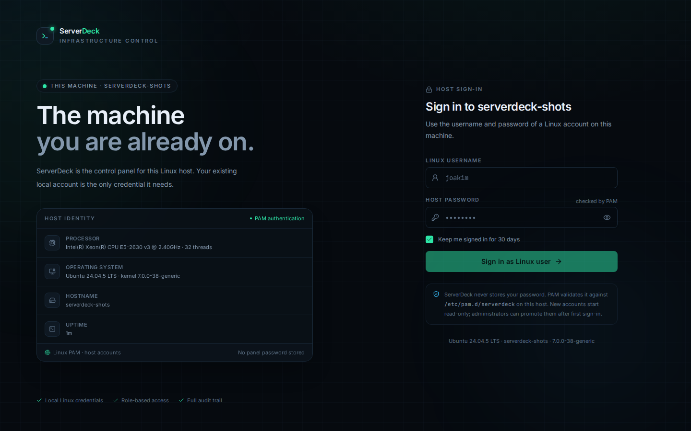
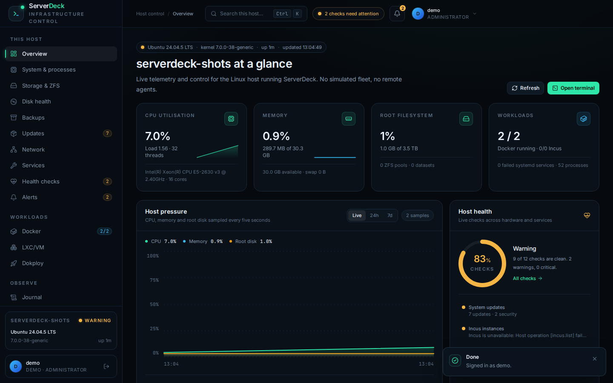
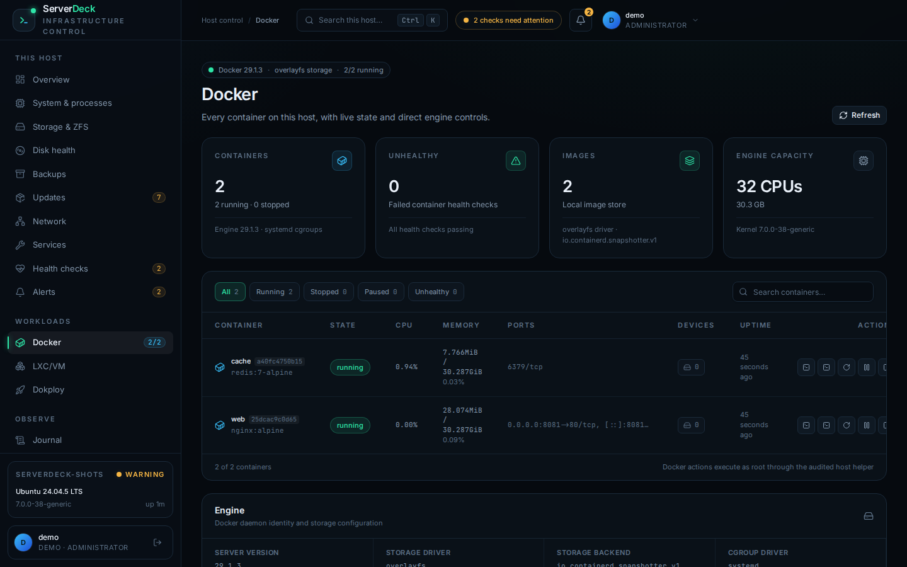
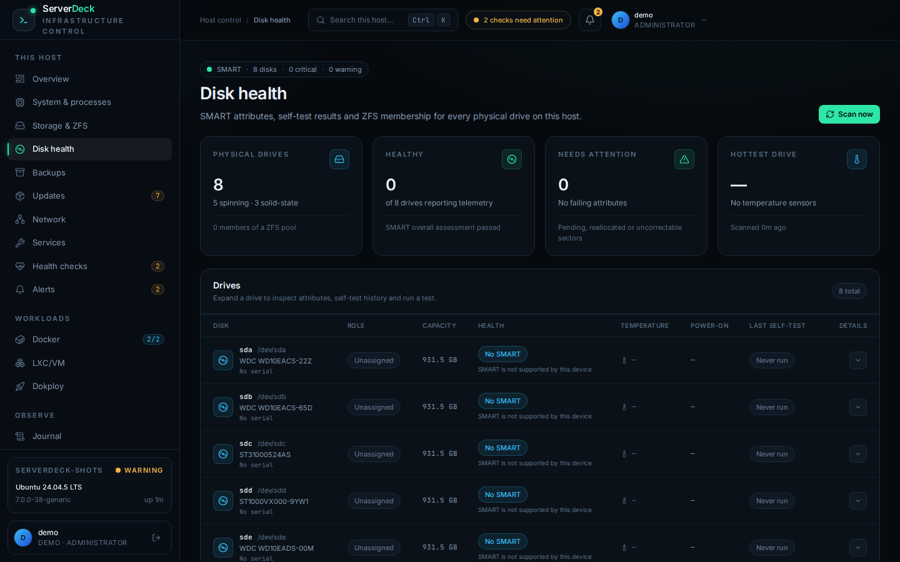

# ServerDeck

[**serverdeck.black.ax**](https://serverdeck.black.ax) ·
[Releases](https://github.com/onjoakimsmind/serverdeck/releases) ·
[Issues](https://github.com/onjoakimsmind/serverdeck/issues)

ServerDeck is a self-hosted control panel for a single Linux host. It combines
the day-to-day host controls usually spread across shell sessions into one
audited interface: Incus containers and VMs, Docker, systemd services, ZFS and
storage, networking and firewall rules, backups, SMART health, package updates,
alerts, metrics, and interactive consoles.

It is built for real hosts, not simulations. Telemetry is read from the machine
it runs on, privileged actions go through a root-owned allow-listed helper, and
authentication uses the host's existing Linux/PAM accounts. ServerDeck does not
store application passwords.

## Screenshots

<p>
  
  
</p>
<p>
  
  
</p>

## Features

- Dashboard and historical metrics for CPU, memory, load, disks, and network
- Incus LXC/VM inventory, consoles, images, networks, disks, and device passthrough
- Docker container inventory, consoles, logs, images, networks, and devices
- Real root PTY terminal on the host
- Storage, ZFS pools/datasets, disk inventory, and SMART health
- Network interfaces, routes, DNS, firewall tables, and firewall rules
- Backups and snapshots with retention controls
- Package updates through APT, DNF/DNF5, or Pacman, including reboot state
- Alert channels, notification routing, and delivery history
- Linux/PAM sign-in with administrator/operator/viewer roles and audit logging

## Architecture

- Laravel, Inertia, and Vue frontend
- FrankenPHP/Caddy static web runtime
- Static PHP CLI for Artisan and the scheduler
- SQLite for panel state
- PyInstaller-built root helper for privileged host operations
- Bundled `pamcheck` utility for PAM authentication
- systemd units for the web service and scheduler

The web process runs as the unprivileged `serverdeck` user. The helper is
root-owned and invoked through one no-argument `sudo` rule. No system PHP,
nginx, Apache, Node, or Composer is required on the target host.

## Supported hosts

- x86_64 Linux with glibc 2.31 or newer
- systemd as PID 1
- Linux-PAM and sudo with `/etc/sudoers.d`
- Debian 11+, Ubuntu 20.04+, Fedora 38+, RHEL/Rocky/Alma 9+, Arch and
  compatible derivatives

Package updates use the native manager:

- APT on Debian and Ubuntu, including security-repository counts
- DNF or DNF5 on Fedora, RHEL, Rocky, and Alma, including security advisories
- Pacman on Arch; install `arch-audit` for CVE mapping, otherwise security
  counts are reported as unavailable

The installer uses the host's native package manager to add two base host
tools by default: `smartmontools` for disk health and `pciutils` for hardware
inventory. The Incus, Docker, and ZFS workloads are opt-in; see
[Host packages](#host-packages).

Alpine/musl, OpenRC, non-x86_64 architectures, and multi-node fleet management
are not part of this release.

## Install

The bootstrap installer resolves the latest stable GitHub release, downloads
the Linux x86_64 archive and its published SHA-256 checksum, verifies the
archive, and then runs the release installer with `sudo`. It's served from
[serverdeck.black.ax](https://serverdeck.black.ax), the project's landing site
(source in [`site/`](site)):

```sh
curl -fsSL https://serverdeck.black.ax/install.sh | sh
```

Installer options pass through with `sh -s --`:

```sh
curl -fsSL https://serverdeck.black.ax/install.sh | sh -s -- --port 8443 --open-firewall
curl -fsSL https://serverdeck.black.ax/install.sh | sh -s -- --workloads incus,docker
```

To install a specific release manually, download the tarball and checksum from
the repository's [Releases](https://github.com/onjoakimsmind/serverdeck/releases)
page. Release tags are built and published by GitHub Actions; the package is not
stored in the Git repository.

```sh
sha256sum -c serverdeck-0.1.0-linux-x86_64.tar.gz.sha256
tar -xzf serverdeck-0.1.0-linux-x86_64.tar.gz
cd serverdeck-0.1.0-linux-x86_64
sudo ./install.sh
```

The default URL is `http://<host-ip>:8090`. Common options:

```sh
sudo ./install.sh --port 8443 --bind 0.0.0.0
sudo ./install.sh --url https://panel.example.com --open-firewall
sudo ./install.sh --no-start
```

Sign in with a local Linux account in `sudo` (Debian/Ubuntu) or `wheel`
(Fedora/RHEL/Arch). The first successful login provisions that account as an
administrator. Other Linux accounts become read-only viewers.

### Host packages

The installer normally installs `smartmontools` and `pciutils` through APT,
DNF/DNF5, or Pacman. These are base host tools used by the SMART and hardware
pages and remain installed after ServerDeck is uninstalled.

Container and storage runtimes are opt-in:

```sh
sudo ./install.sh --workloads incus
sudo ./install.sh --workloads incus,docker
sudo ./install.sh --workloads all
```

The supported workload names are `incus`, `docker`, and `zfs`. Package names
are resolved per distribution: for example Docker uses `docker.io` on APT,
`moby-engine` on Fedora, and `docker` on Arch. ZFS requires a distribution
repository that provides OpenZFS; it is not available in the official Fedora
or Arch repositories, so `--workloads zfs` fails there with the package
manager output. Docker CE repositories are likewise not added automatically.

Use `--no-packages` to skip all package installation and manage host packages
yourself. The installer records the packages it installs in
`/etc/serverdeck/workload-packages.conf`, including dependencies pulled in for
an opt-in workload. Only packages that ServerDeck installed are eligible for
removal; packages that were already present are never removed. See
[Uninstall](#uninstall).

## Operations

```sh
sudo serverdeck status
sudo serverdeck doctor
sudo serverdeck restart
sudo serverdeck logs -f
sudo serverdeck artisan migrate:status
```

The installer supports upgrades from a newer tarball. It preserves
`/var/lib/serverdeck` and `/etc/serverdeck`, backs up SQLite before migrations,
keeps the previous release, and rolls back automatically if migrations or the
health check fail. Package installation happens before the running service is
stopped, so a package failure does not interrupt an existing installation.

## Uninstall

```sh
sudo ./install.sh --uninstall
sudo ./install.sh --uninstall --remove-workloads
sudo ./install.sh --uninstall --purge --yes
```

A plain uninstall removes the application but keeps configuration, data, base
host tools, and workloads. `--remove-workloads` also removes the opt-in Incus,
Docker, or ZFS packages that ServerDeck installed. `--purge` removes the
configuration and data as well. Packages that existed before ServerDeck are
never removed. Workload data such as `/var/lib/incus` and `/var/lib/docker` is
left in place. See [`packaging/README.md`](packaging/README.md) for details.

## Development

Build requirements: PHP 8.5, Composer, Node/npm, and a Linux environment with
PAM and sudo for host integration.

```sh
composer install
cp .env.example .env
php artisan key:generate
touch database/database.sqlite
php artisan migrate
npm install
npm run build
composer run dev
```

Run the test suite and formatter:

```sh
php artisan test
vendor/bin/pint --dirty --format agent
```

To exercise privileged host operations in development, install or point
`SERVERDECK_HOSTCTL` at a locally built `serverdeck-hostctl`. The packaged
helper can be rebuilt with:

```sh
sh packaging/scripts/build-helper.sh packaging/.build/helper
```

## Packaging

Releases are built by the [CI workflow](.github/workflows/release.yml). Every
push to `main`, every pull request, and every `v*` tag runs the tests, Pint,
and the packaging build. The tarball and checksum are uploaded as a workflow
artifact. A tag matching `packaging/VERSION` publishes them to GitHub Releases.

To build the same archive locally on a host with Docker, Composer, and Node:

```sh
sh packaging/scripts/build-release.sh --rebuild-assets
```

The helper is built in a Debian 11 image for glibc 2.31 compatibility.
FrankenPHP and static PHP versions and checksums are pinned in
`packaging/scripts/build-release.sh`. Build outputs under `packaging/dist` and
`packaging/.build` are ignored by Git.

To publish a release, update `packaging/VERSION`, commit the change, and push a
matching annotated tag:

```sh
version=$(cat packaging/VERSION)
git tag -a "v${version}" -m "ServerDeck ${version}"
git push origin main "v${version}"
```

The workflow rejects a tag whose version differs from `packaging/VERSION`.

## Security

The default listener is plain HTTP. Put ServerDeck behind a TLS-terminating
reverse proxy or bind it to a trusted management network. The privileged helper
validates every operation and path, and all arguments are passed as JSON on
stdin. Console output and keystrokes are never written to the audit log.

## License

ServerDeck's own source is MIT-licensed. Bundled third-party components retain
their respective licenses; see
[`packaging/THIRD-PARTY-NOTICES.md`](packaging/THIRD-PARTY-NOTICES.md).

## Links

- Website and installer: <https://serverdeck.black.ax>
- Releases: <https://github.com/onjoakimsmind/serverdeck/releases>
- Issues: <https://github.com/onjoakimsmind/serverdeck/issues>
